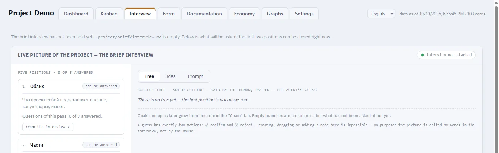
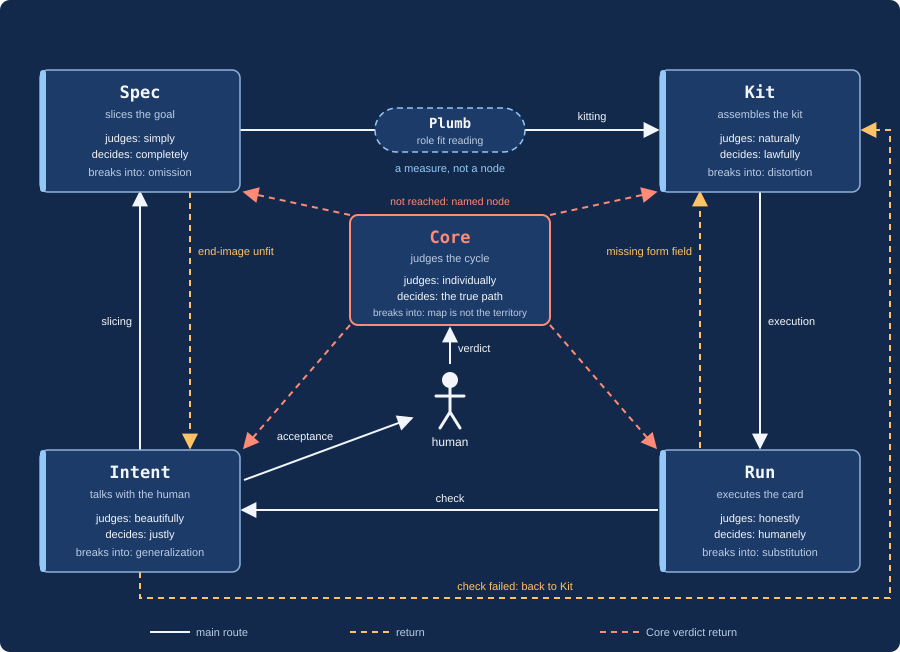
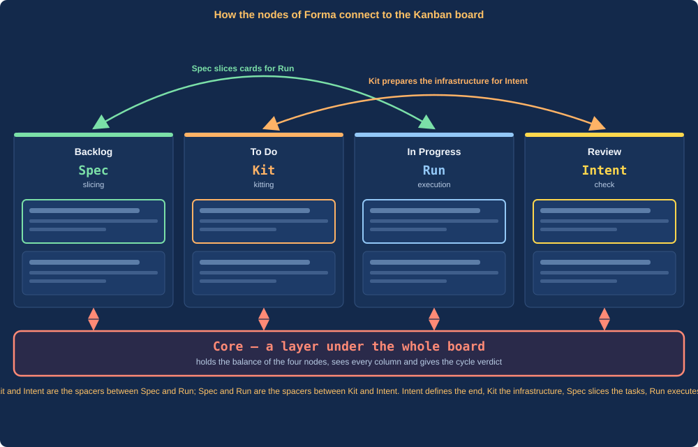
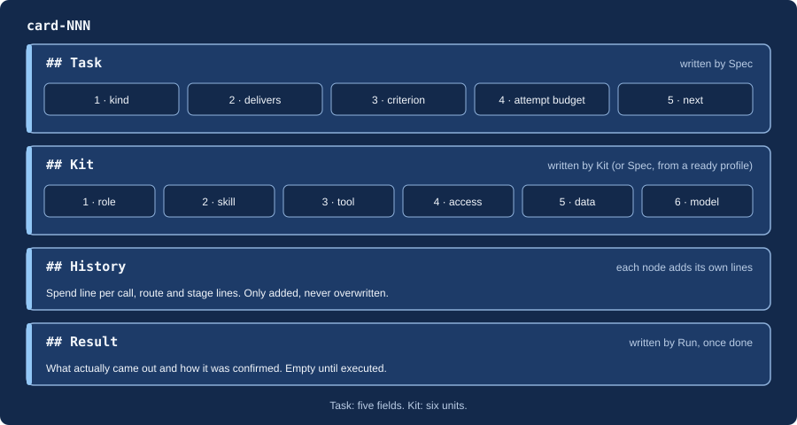
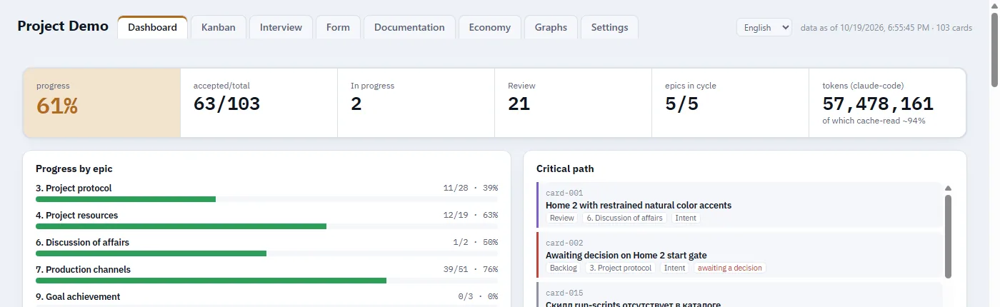
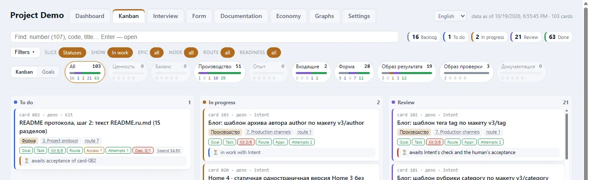
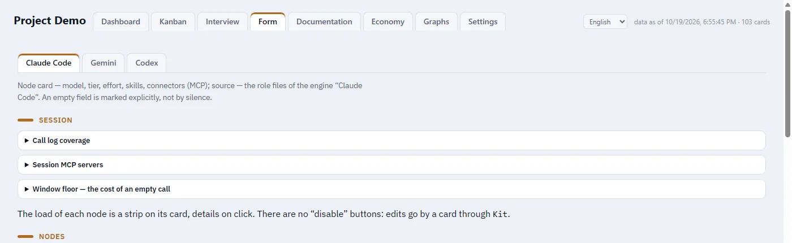
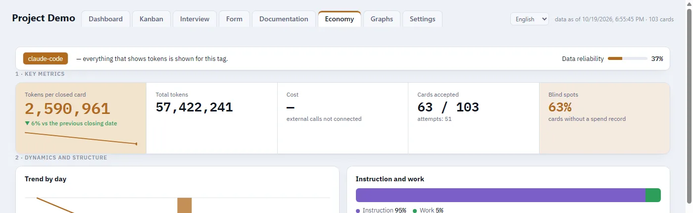
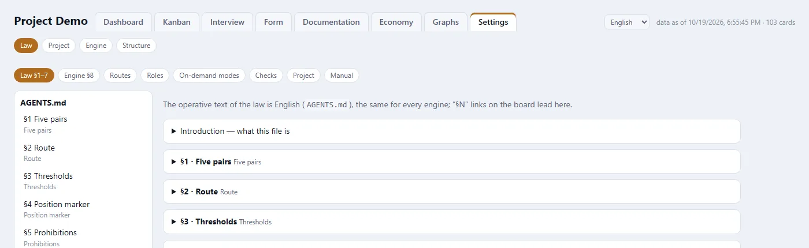
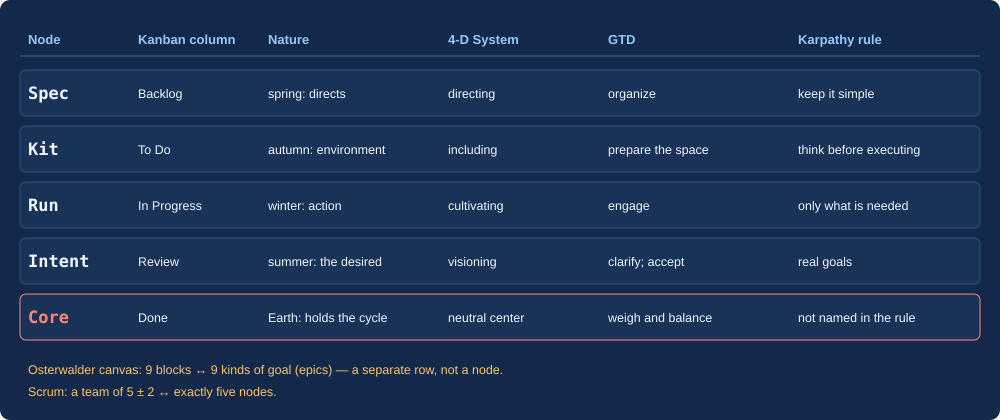

<p align="center"></p>

<h1 align="center">Forma — five-node project management protocol</h1>

<p align="center"><b>For humans and AI agents. Natural workflow: from intent to verified result.</b></p>

<p align="center"><b>English</b> · <a href="README.ru.md">Русский</a></p>

<p align="center">


</p>

<p align="center"><b><a href="https://iamforma.pro/#intro">iamforma.pro</a></b> · <a href="https://yaforma.pro/">Russian: yaforma.pro</a> · <a href="https://github.com/IamForma/forma">IamForma/forma</a></p>

[](https://iamforma.pro/#intro)

## What it is

Forma is a project management protocol for AI agents. Work is divided between five nodes: `Intent`, `Spec`, `Kit`, `Run`, `Core`. Each task is a card on a Kanban board with a readiness criterion written in advance. The result is accepted by someone other than its author. The thesis: an agent cannot check itself — over the long haul, impression replaces fact-based verification.

The protocol already incorporates well-known methodologies: Scrum, 4-D System, GTD, Osterwalder's canvas, the Karpathy rule ([how they map to the five nodes](#why-five-and-nine-correspondence-with-methodologies)).

**The heart of Forma is three actions. They set it apart from other tools:**

1. **Understands what needs to be done.** Through an interview, the idea becomes clear.
2. **Breaks it into understandable steps.** The goal turns into cards with a readiness criterion.
3. **Sees everything through to completion.** The result is verified, accepted, the cycle closed.

## Requirements

Mandatory requirement: work in **VS Code** or **Antigravity** with the **[Kanban Markdown](https://marketplace.visualstudio.com/items?itemName=LachyFS.kanban-markdown)** (LachyFS) extension. This is the core functionality of the system: the extension renders a board from card-files `.devtool/features/*.md`, nodes move across it, and the user sees the progress of work through it. Without the board, the protocol does not work.


| You need | Why |
|---|---|
| **VS Code** or **Antigravity** | The editor where the board lives. |
| **Kanban Markdown** | The board. The installer sets it up automatically (`--board auto`); manually: `code --install-extension LachyFS.kanban-markdown`. |
| **Claude Code** | The engine on which nodes run (Gemini — beta; Codex is dormant). |
| **Node 18+** and **Git** | Installer and protocol scripts. |
| **`bash`** | Claude Code hooks; on Windows — Git for Windows. Verification: `node .forma/verify/verify-install.cjs`. |

## Quick install

From the project folder:

```
npx github:IamForma/forma init
```

The installer will ask three questions — engines (`claude`), project template (`none`), kanban board (`auto`) — and will install the core: `AGENTS.md`, roles, hooks, board, dashboard. Re-running updates the system; `project/` is left untouched. Non-interactive: `npx github:IamForma/forma init --engines claude --template none --board auto`. Other methods — git clone and the Claude Code plugin: [Installation](#installation).

## From the author

I spent a year studying artificial intelligence and using it as a project management tool. I tried different approaches: spec-driven development, GTD (Getting Things Done), and others. All of them are good and work. But each has its edge:

- some are tied to rigid structure and offer little flexibility;
- others offer plenty of flexibility but lack internal structure.

Forma is built differently: it lets you dig deep and grow tall. Rigidity, flexibility, and scale are built in; there is no project-size limit. Need strict structure — it's there. Need freedom — it's there too. Suitable for any project, from small to large, and for simple tasks if there are more than two or three. Works with multiple agents at once and in a single agent flow.

## Interview: where it all begins

In Forma there is an interview. It is the first of three steps: it turns "there's an idea" into a clear goal. It asks questions until the idea becomes clear; your answers are recorded in `project/brief` as an anchor point. Next, `Spec` breaks the goal into cards with a readiness criterion, and the result is checked against the criterion, accepted by a human, and `Core` evaluates the cycle. Didn't reach it — the cycle repeats on what remains.



## How it works

### In 30 seconds

| What | How |
|---|---|
| Who works | Five nodes — five roles of one body: `Intent` → `Spec` → `Kit` → `Run` → `Core`. |
| What is a task | A card on the board: what to deliver, by what criterion to accept it, how many attempts. |
| Who accepts | Not the one who did it: `Intent` checks, a human accepts, the cycle is evaluated by `Core`. |
| What makes it more accurate and cheaper | `Plumb` on JEV technology selects a ready role for the task, so preparation is not repeated ([see below](#plumb-and-jev-precise-role-matching)). |

## Who needs it and when

**Needed for any project — from small to large — where work is organized as a process.** Forma manages not a single task, but a project system: a flow of connected tasks, each with a goal, criterion, and verification.

- **Suited for:** a developer or project owner who runs work through an AI agent and wants a verifiable result, not "sort of done"; a project with a flow of tasks, repeating cycles, multiple agents, or sessions; and a small project, if it has more than one task and keeping the thread matters.
- **Not needed** for a single question or a one-time fix of one file: there's nothing to manage, and the overhead won't pay off.

Simple rule: if you need an answer — ask the agent; if you need to bring a whole project to a result — that's Forma.

## What this is based on: the natural order of things

Forma was born from inspiration by the natural course of nature: the way nature itself orders life, and the way people have built their own lives around it for centuries. The same order underpins modern project management approaches, even if their authors didn't always realize it. That's why any project tool fits into Forma, with no restrictions. The basic ones are already included: Scrum, 4-D System, GTD, Osterwalder's canvas, the Karpathy rule ([how they map to the five nodes](#why-five-and-nine-correspondence-with-methodologies)). The list will grow: over time other tools connected to the same order will be added here.

Forma doesn't invent the order — it takes the one nature itself is built on. Every undertaking passes through the seasons, and each season has its own work: spring directs, summer gives what is desired, autumn defines the environment, winter acts and prepares the next cycle. Above all this is Earth, which holds the whole cycle.


| Season | Node | What it does |
|---|---|---|
| Spring | `Spec` | directs: sets the direction of growth, parts and boundaries, readiness criterion |
| Summer | `Intent` | desired result: the image of what we want and what we're doing it for |
| Autumn | `Kit` | defines the environment: draws conclusions about the environment and assembles role, skill, tool, access, data for the task |
| Winter | `Run` | acts: executes and thereby prepares the ground for the next cycle |
| Earth | `Core` | holds the cycle: the balance of the four and the verdict on the cycle |

Winter prepares the next spring, so the cycle doesn't end but repeats on the remainder. As in nature, nothing is done out of season, and each node has its own work; it's checked not by the one who did it.

## Five nodes



The five are one body. Each judges by its pair of criteria; without the second half, the criterion degenerates.

| Node | Judges | Holds to | Loses, if the pair breaks | Border feeling (keeps the balance) |
|---|---|---|---|---|
| `Intent` | beautifully | justice | generalization | fear |
| `Spec` | simply | perfection | omission | sadness |
| `Kit` | naturally | lawfulness | distortion | joy |
| `Run` | honestly | humanity | substitution | disgust |
| `Core` | individually | the true path | "the map is not the territory" | anger |

`Plumb` (plumb line) is not a sixth node but a measure: between slicing and execution it reads how well the role fits the task. It decides and confirms nothing; `Spec` decides.

## How it works

The work proceeds in a cycle of five nodes. It begins at `Intent` bottom left, then clockwise: `Spec` top left, `Kit` top right, `Run` bottom right; in the center is `Core`. `Plumb` is attached to `Spec`.


1. `Intent` opens the goal together with the human.
2. `Spec` slices the goal into cards and writes the readiness criterion.
3. `Plumb` reads whether a role from the catalog fits. If it fits, the card goes straight to `Run`.
4. If it doesn't fit, `Kit` gathers the kit (six units) and creates or fixes the role.
5. `Run` executes the card.
6. `Intent` checks the result against the criterion; if it fails, the card returns to `Kit`.
7. The human accepts the visible result.
8. `Core` delivers the verdict on the cycle: has the end-image been achieved? If not, a node is named and the cycle repeats on the remainder.

There is no direct return to `Run`: the card is always reassembled by `Kit`.

## Plumb and JEV: precise role matching

To avoid preparing each task from scratch, Forma maintains a **catalog of ready-made roles** for executors — each records which tasks it accepts and which it does not. Between slicing and execution, `Plumb` (the plumb line) works: it reads the card and the catalog and suggests which role fits most precisely.

`Plumb` reads using **JEV** technology — a decision model that does not write text or explain anything, but returns three typed readings:

| Reading | What it returns |
|---|---|
| choice | which role is closest, with probability for each |
| clarity | how clearly the task is formulated |
| "will take" | whether the leading role will take this particular task, yes or no |

The decision is made not by `Plumb`, but by `Spec`: using thresholds from `project/config/PROJECT.md` (leading role probability and margin over the second). If the role fits — the card goes straight to `Run`, without kitting. If not — `Kit` creates a precise role and adds to the catalog, so with each cycle the share of cards that need `Kit` becomes smaller.

**What this provides:**
- **Lower preparation costs.** The role is already ready — the task is not assembled from scratch.
- **Precise use of competencies.** Each task is taken by a role with suitable qualifications, chosen by probability, not by eye.
- **The catalog grows.** Each `Kit` assembly leaves or expands a role for future tasks.

JEV is the recommended executor for `Plumb`; switched with a single command `node .claude/scripts/plumb-switch.cjs` and requires a key in `.env`. Without a key, on error, or if cleaning is refused, the built-in small model (haiku) works automatically. Only cleaned card text goes to the external model: values from `VARS/` and `.env` are replaced with names, addresses and tokens are scrubbed (prohibition 17).

## How nodes relate to the Kanban board

The four columns of the board are the four nodes: Backlog — `Spec`, To Do — `Kit`, In Progress — `Run`, Review — `Intent`. The fifth, `Core`, lies beneath the board as a layer and is connected to all four: it holds their balance and delivers the verdict for the cycle. Two arcs above show the paired "gaskets": `Spec` cuts cards for `Run`, and `Kit` prepares infrastructure for the goal that `Intent` defines. `Kit` and `Intent` stand between `Spec` and `Run`, while `Spec` and `Run` stand between `Kit` and `Intent`.



| Column | Node (`assignee`) | What happens |
|---|---|---|
| Backlog | `Spec` | card is cut, readiness criterion recorded |
| To Do | `Kit` | six units of kit assembled, role selected |
| In Progress | `Run` | card is executed with the ready kit |
| Review | `Intent` | result is checked against the criterion and shown to the human |
| Done (beneath the board) | `Core` | human accepted; `Core` closes the cycle with a verdict |

Returns follow the same columns: if the check fails — the card goes from Review to To Do, to `Kit`; if the verdict is not reached — to the node named by `Core`.

## What a task card looks like

A task is one card: an ordinary `.md` file in `.devtool/features/` that Kanban Markdown displays on the board and opens as a form. It has two layers: service fields at the top and four text zones.



```
---
id: "card-NNN-contacts-page"
status: "in-progress"          # backlog → todo → in-progress → review → done
priority: "medium"
assignee: "Run"                # which node holds the card now
epic: "7. Production channels" # stripe of cards with the same goal kind
labels: ["goal-channels", "route-7"]   # goal and route
order: "a0"
---
# card-NNN · Contacts page

## Task
NNN · work | page with contact form | form sends email, fields
are validated, page opens on mobile | 2 attempts | to Intent for review

## Kit
Role · Skill · Tool · Access · Data · Model

## History
- `Spec`, YYYY-MM-DD: stage card — card staged.
- `Kit`, YYYY-MM-DD: attempt, N tokens, T s — kit assembled.

## Result
(empty until execution)
```

| Part | What's in it | Who writes |
|---|---|---|
| Service fields | `status` (board column), `assignee` (node holding the card), `epic`, goal and route labels | the node that takes the card |
| `## Task` | five fields: kind · what it delivers · readiness criterion · attempt budget · where next | `Spec` |
| `## Kit` | six units: role, skill, tool, access, data, model | `Kit` |
| `## History` | one line per event: stage, attempt, token cost, return | each node about its own event, does not overwrite others' |
| `## Result` | what was actually delivered, not chronology | `Run`, when ready |

Cards are moved across columns by nodes: `status` and `assignee` change together. An accepted card goes to `Done`.

## Dashboard

Besides the board in the editor, Forma has its own dashboard — a local project page that starts automatically when the session begins, with the link arriving in the first message. It only displays state: cards are edited on the board. There are eight tabs; below are the top six main ones; two more are "Documentation" (protocol documentation right in the dashboard) and "Graphs" (graphs of the manual, engine, experience, project, and result).

**Dashboard** — progress by epic, critical path, card table.



**Kanban** — project board with filters by goal, epic, and node.



**Interview** — the person's answers before the first goal — anchor point `project/brief`.


**Forma** — card for each node: model, skills, connectors, load.



**Economy** — token and cache consumption by nodes and cards.



**Settings** — thresholds, routes, external services.



## Working phrases

You talk to the protocol through `Intent` — the main session. The wording is free-form; only the code phrase is fixed.

| What to say | What happens |
|---|---|
| «Отключи сенсорику» ("Disable sensorics") | Code phrase (exactly as written). Grants one-time permission: to remove protection from schema file deletion **or** to step outside the route for a named task. Not a persistent state; a record of this remains in the card history. |
| "Show the dashboard" | `Intent` gives the dashboard address (`http://localhost:5050/`); it starts with each session, manually — `node .forma/dashboard/ensure-running.js`. |
| "Update Forma" | Protocol update in the project (`/forma` skill); `project/`, board and history remain untouched. |
| "Remove Forma" / "remove the protocol" | First a dry run with a list: what will be removed, what will remain (`project/`, `.devtool/`, `.env`, `.mcp.json`). The actual removal — only after a message with the code phrase «Отключи сенсорику» ("Disable sensorics"). |
| "Access level: minimal / standard / full" | Enables a set of agent permissions; takes effect from the next session. `--show` displays the current level, `--off` removes it. |
| "Pass the cycle to Core" | Close the epic cycle with a `Core` verdict: normally when the volume threshold is reached, earlier — by your command. |
| "Let's run the demo cycle" | Two small cards through the entire route in a few minutes; afterward — removed, not counted in statistics. |

## Nodes

| Node | What it does | Judges | Returns to |
|---|---|---|---|
| `Intent` | main session with the human: opens the goal, checks the result, presents the cycle | beautifully | to `Kit` when the check fails; to `Spec` if what was done doesn't lead to the goal |
| `Spec` | slices the goal into cards, writes the criterion | simply | to `Intent` if the end-image allows multiple readings |
| `Kit` | assembles the kit, creates and repairs roles | naturally | to `Spec` if the issue is in the card, not the kit; to the human if the tool doesn't exist |
| `Run` | executes with a ready kit | honestly | to `Kit` if a form field is missing |
| `Core` | verdict on the cycle | individually | to the named node, then the next cycle |

## Why Five and Nine: Correspondence with Methodologies

Forma is not assembled from methodologies — it describes the natural way any collaborative work organizes itself. Therefore, well-known project management systems map onto it as special cases: **five nodes** and **nine types of goal (epics)** — a common framework. Below are the methodologies already mapped; the list is growing.



| Methodology | How it maps to Forma |
|---|---|
| **Karpathy Rule** (four principles of AI agent work) | Real goals — `Intent`; don't overcomplicate — `Spec`; think before executing — `Kit`; do only what is necessary — `Run`. `Core` is not named in the rule — it verifies that the four work together. |
| **Scrum** (team 5 ± 2) | Exactly five nodes. |
| **4-D System** | Visionary — `Intent`; directing — `Spec`; including — `Kit`; cultivating — `Run`; neutral center uniting the four — `Core`. |
| **GTD** | Define — `Intent`; break down — `Spec`; prepare space — `Kit`; execute — `Run`; accept or return — `Intent` and the person; weigh nodes and balance — `Core`. |
| **Kanban** | Five board columns — five nodes ([diagram above](#how-nodes-relate-to-the-kanban-board)). |
| **Osterwalder's Canvas** | Nine canvas blocks — nine types of goal, one to one (table below). |

Business model canvas and nine epics:

| № | Epic | Canvas block |
|---|---|---|
| 1 | Analytics | Value propositions |
| 2 | Project structure | Cost structure |
| 3 | Project protocol | Key activities |
| 4 | Project resources | Key resources |
| 5 | Forma balance | Key partners (four nodes under `Core` management) |
| 6 | Discussion of affairs | Customer relationships |
| 7 | Production channels | Channels |
| 8 | Competence segments | Customer segments |
| 9 | Goal achievement | Revenue streams |

Author's thesis: this framework has no alternative — other methodologies (PMBOK, Kanban, PRINCE2, OKR, Lean, Agile) can be mapped to it the same way. Details in the [guide](#full-documentation).

## Key concepts

| Term | Definition |
|---|---|
| Node | One of five roles; each has its own pair of criteria. |
| Card | A file on the `.devtool/features/` board: Task, Kit, History, Result. |
| Five fields | Kind and "what it gives" · readiness criterion · attempt budget · where next. |
| Six kit units | Role, skill, tool, access, data, model. |
| Epic | A lane of cards of one goal kind; carries no route itself. |
| Goal | Image of the result; a card has exactly one `goal-…` label. |
| Route | Nine card paths `route-0…8`, from short to full cycle (`route-7`); `over-1…4` labels alter one link. |
| Cycle | Accepted cards of an epic that `Core` closes together with a verdict. |
| Thresholds | Two numbers in `PROJECT.md`: attempts per task, card volume per cycle. |
| Spend line | A line in `## History`: tokens, cache, time, call id; the caller writes it immediately after return. |
| Position marker | First line of handoff: `holding course`, `counting cost`, `assembling`, `preserving`. |
| Purity zones | Files going to other projects contain no traces of the project (prohibition 16). |
| Prohibitions | 18 fixed rules in `AGENTS.md` §5; the number is a permanent address. |
| File layers | Engine roles and skills · `.forma/` core · project extensions · `project/` product. |

## Installation

**Requirements:** everything from [requirements](#requirements) — first of all VS Code or Antigravity with the Kanban Markdown extension.

**Method 1 — installer (recommended).** From the project folder:

```
npx github:IamForma/forma init
```

The installer asks: engines (`claude` ready; `gemini` — beta; `codex` is dormant — not offered and not installed until it is woken in `core/engines.json`), project template (or no template), kanban board, document language, auto-compaction window. Non-interactive: `npx github:IamForma/forma init --engines claude --template none --board auto`. No npm registry package — only `github:`.

**Method 2 — git clone.**

```
git clone https://github.com/IamForma/forma.git protocol
```

Then in a Claude Code session: "read protocol/skills/forma/SKILL.md and install Forma protocol from it". Update: `git -C protocol pull`, then "Update Forma".

**Method 3 — Claude Code plugin.**

```
claude plugin marketplace add IamForma/forma
claude plugin install forma@forma
```

Then in the project: `/forma`. If the update doesn't appear after `marketplace update`, the plugin cache is stale — use method 2.

**Project templates.** A template adds a ready-made route for a work type on top of the core; chosen by installer question. With method 2 they are in `protocol/templates/<name>/`.

**After installation.**

- Dashboard starts with each session; manually: `node .forma/dashboard/ensure-running.js`.
- Installation check: `node .forma/verify/verify-install.cjs`.
- Set two thresholds (attempts, volume) in `project/config/PROJECT.md`.
- Interview per `project/config/SETUP.md` is conducted by `Intent`; in the first session it offers a short demo cycle.

## File structure after installation

```
AGENTS.md          the law, §1–7
.claude/           Claude Code adapter: agents/, hooks/, scripts/, skills/, rules/, settings.json
.codex/  .agents/  Gemini adapter (beta); Codex is dormant (not installed)
.forma/            core: board/, dashboard/, manual/, living/, verify/, extensions/, i18n/,
                   install-manifest.json, protocol/ (clone with method 2)
project/           product: config/, brief/, extensions/, cards/, ops/ — updates do not touch
.devtool/features/ card board; done/ — accepted
```

Three layers (`AGENTS.md` §6): 1 — engine roles and skills; 2 — `.forma/`, core, one for all projects; 3 — product (`project/`, `.forma/living/`, `.devtool/`), with project extensions in `project/extensions/<engine>/`.

## Version and updates

- **Current version.** `npx github:IamForma/forma --version`; inside a project — the `version` field in `.forma/install-manifest.json`.
- **Notification.** Once a day at session start, the Claude Code hook compares the version with the latest on GitHub and reports only if GitHub has a newer one. Without network access it stays silent.
- **Update.** Run `npx github:IamForma/forma init` again in the project folder; `project/`, the board, and `living/` are preserved.
- **Update without questions.** `npx github:IamForma/forma init --yes` pulls the latest version from GitHub and overwrites the schema configuration with no menu and no prompts (defaults for anything missing). Add `--no-adopt` to skip the first-install question about moving root files, `--no-dashboard` not to start the dashboard. Only the project extensions: `npx github:IamForma/forma extensions` (`--check` reports without copying).
- **Auto-compaction window.** The installer suggests 250000 tokens (`.claude/settings.json`) and does not overwrite your existing value. `--compact <tokens>` sets a different limit, `--compact off` leaves the Claude Code default.

## If something doesn't work

- **The installer produced no output.** Repeat the command; if empty again — delete the `_npx` folder in the npm cache (`npm config get cache`) and repeat. Cause — stale `npx` cache.
- **Hooks do nothing.** Claude Code runs hooks through `bash`. On Windows install Git for Windows and repeat installation. Check: `node .forma/verify/verify-install.cjs`.
- **Command blocked by guard-delete hook.** Files and folders of the schema itself (`.claude/`, `.agents/`, `.codex/`, `.devtool/`, `.forma/manual/`, `.forma/living/`, `AGENTS.md`, `PROJECT.md`, any `GOAL.md`) are protected from deletion. To allow exactly one command — use the code phrase from `AGENTS.md` §2.

## Full documentation

- Website: [yaforma.pro](https://yaforma.pro/) (RU), [iamforma.pro](https://iamforma.pro/#intro) (EN) — how it works, community.
- Manual: `.forma/manual/ru/` and `.forma/manual/en/` (in the repository — `skills/forma/core/manual/`).
- Previous detailed README: [ru](skills/forma/core/manual/ru/archive/README-full.md) · [en](skills/forma/core/manual/en/archive/README-full.md).
- New engine adapter: [docs/ADAPTER.ru.md](docs/ADAPTER.ru.md).

## Contribution and development

- Protocol commits — English only (prohibition 18); a message with Cyrillic stops `forma-commit.cjs` and the pre-push check.
- Before release: `npm test`, `npm run lint`, `npm run check:release`.
- Work happens in the `dev` branch; release to `main` — `forma-commit.cjs --release`.

## License

[MIT](LICENSE)
