<p align="center"></p>

<h1 align="center">Форма — пятиузловой протокол управления проектами</h1>

<p align="center"><b>Для человека и ИИ-агентов. Естественный ход дела: от замысла до проверенного результата.</b></p>

<p align="center"><a href="README.md">English</a> · <b>Русский</b></p>

<p align="center">


</p>

<p align="center"><b><a href="https://yaforma.pro/">yaforma.pro</a></b> · <a href="https://iamforma.pro/#intro">English: iamforma.pro</a> · <a href="https://github.com/IamForma/forma">IamForma/forma</a></p>

[](https://yaforma.pro/)

## Что это

«Форма» — протокол ведения проекта для ИИ-агентов. Работа делится между пятью узлами: `Intent`, `Spec`, `Kit`, `Run`, `Core`. Каждая задача — карточка на канбан-доске с критерием готовности, записанным заранее. Результат принимает не тот, кто его сделал. Тезис: агент не может проверить сам себя — на длинной дистанции впечатление подменяет проверку по факту.

В протокол уже включены известные методики: Scrum, 4-D System, GTD, канва Остервальдера, правило Карпаты ([как они ложатся на пять узлов](#почему-пять-и-девять-соответствие-методикам)).

**Сердце «Формы» — три действия. Они отличают её от других инструментов:**

1. **Понимает, что нужно сделать.** Через интервью идея становится ясной.
2. **Разбивает на понятные шаги.** Цель превращается в карточки с критерием готовности.
3. **Доводит всё до завершения.** Результат проверен, принят, круг закрыт.

## Что нужно для работы

Обязательное условие: работать в **VS Code** или **Antigravity** с расширением **[Kanban Markdown](https://marketplace.visualstudio.com/items?itemName=LachyFS.kanban-markdown)** (LachyFS). Это основной функционал системы: расширение рисует доску из карточек-файлов `.devtool/features/*.md`, по ней двигаются узлы и по ней человек видит ход работы. Без доски протокол не работает.

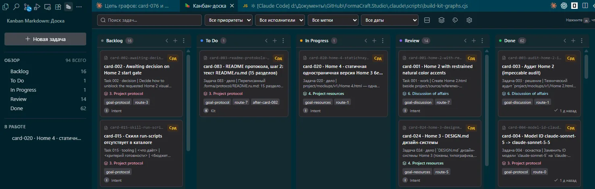

| Нужно | Зачем |
|---|---|
| **VS Code** или **Antigravity** | Редактор, в котором живёт доска. |
| **Kanban Markdown** | Доска. Установщик ставит сам (`--board auto`); вручную: `code --install-extension LachyFS.kanban-markdown`. |
| **Claude Code** | Движок, на котором идут узлы (Codex и Gemini — бета). |
| **Node 18+** и **Git** | Установщик и скрипты протокола. |
| **`bash`** | Хуки Claude Code; на Windows — Git for Windows. Проверка: `node .forma/verify/verify-install.cjs`. |

## Быстрая установка

Из папки проекта:

```
npx github:IamForma/forma init
```

Установщик задаст три вопроса — движки (`claude`), шаблон проекта (`none`), канбан-доска (`auto`) — и поставит ядро: `AGENTS.md`, роли, хуки, доску, дашборд. Повторный запуск — обновление, `project/` не трогается. Без вопросов: `npx github:IamForma/forma init --engines claude --template none --board auto`. Другие способы — git-клон и плагин Claude Code: [Установка](#установка).

## От автора

Год я изучал искусственный интеллект и использовал его как инструмент управления проектами. Пробовал разные подходы: spec-driven разработку, GTD (Getting Things Done) и другие. Все они хорошие и работают. Но у каждого свой край:

- одни привязаны к жёсткой структуре и дают мало гибкости;
- другие дают много гибкости, но без внутренней структуры.

«Форма» устроена иначе: она позволяет копать в глубину и расти в высоту. Жёсткость, гибкость и масштаб заложены внутри, предела по размеру проекта нет. Нужна строгая структура — она есть. Нужна свобода — она тоже есть. Подходит для любого проекта, от малого до крупного, и для простых задач, если их больше двух-трёх. Работает с множеством агентов сразу и в одном агентском потоке.

## Интервью: с чего всё начинается

В «Форме» есть интервью. Это первый из трёх шагов: оно превращает «есть идея» в понятную цель. Задаёт вопросы, пока идея не станет ясной; ваши ответы фиксируются в `project/brief` как опорная точка. Дальше `Spec` разбивает цель на карточки с критерием готовности, а результат проверяется по критерию, его принимает человек, а `Core` оценивает круг. Не дошли — круг повторяется на остатке.

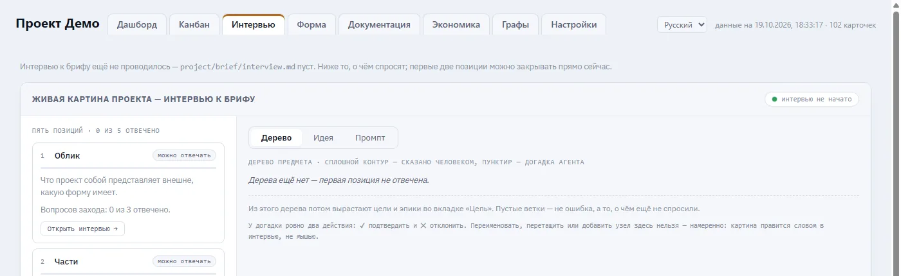

## Как это работает

### За 30 секунд

| Что | Как |
|---|---|
| Кто работает | Пять узлов — пять ролей одного тела: `Intent` → `Spec` → `Kit` → `Run` → `Core`. |
| Что такое задача | Карточка на доске: что дать, по какому критерию принять, сколько попыток. |
| Кто принимает | Не тот, кто делал: проверяет `Intent`, принимает человек, круг оценивает `Core`. |
| Чем точнее и дешевле | `Plumb` на технологии JEV подбирает готовую роль под задачу, поэтому подготовка не повторяется ([см. ниже](#plumb-и-jev-точный-подбор-роли)). |

## Для кого и когда нужен

**Нужна для любого проекта — от небольшого до крупного, — где работа организована как процесс.** «Форма» управляет не одной задачей, а проектной системой: потоком связанных задач, у каждой из которых есть цель, критерий и проверка.

- **Подходит:** разработчику или владельцу проекта, который ведёт работу через ИИ-агента и хочет проверяемый результат, а не «вроде готово»; проекту с потоком задач, повторяющимися циклами, несколькими агентами или сессиями; и малому проекту, если в нём больше одной задачи и важно не терять нить.
- **Не нужна** для одного вопроса или разовой правки одного файла: там нечем управлять, и накладные расходы не окупятся.

Простое правило: если вам нужен ответ — спросите агента; если нужно довести до результата целый проект — это «Форма».

## На чём это основано: природный порядок дел

«Форма» родилась из вдохновения естественным ходом природы: тем, как сама природа упорядочивает жизнь, и тем, как люди веками выстраивали по нему свою. На этом же порядке держатся современные подходы к управлению проектами, пусть их авторы и не всегда это осознавали. Поэтому в «Форму» вписывается любой проектный инструмент, ограничений нет. Базовые из них уже включены: Scrum, 4-D System, GTD, канва Остервальдера, правило Карпаты ([как они ложатся на пять узлов](#почему-пять-и-девять-соответствие-методикам)). Список будет расти: со временем сюда добавятся и другие инструменты, связанные с тем же порядком.

«Форма» не выдумывает порядок — она берёт тот, по которому устроена сама природа. Любое дело проходит времена года, и у каждого времени своя работа: весна направляет, лето даёт желаемое, осень определяет окружение, зима действует и готовит следующий цикл. Над всем этим — Земля, которая держит круг целиком.

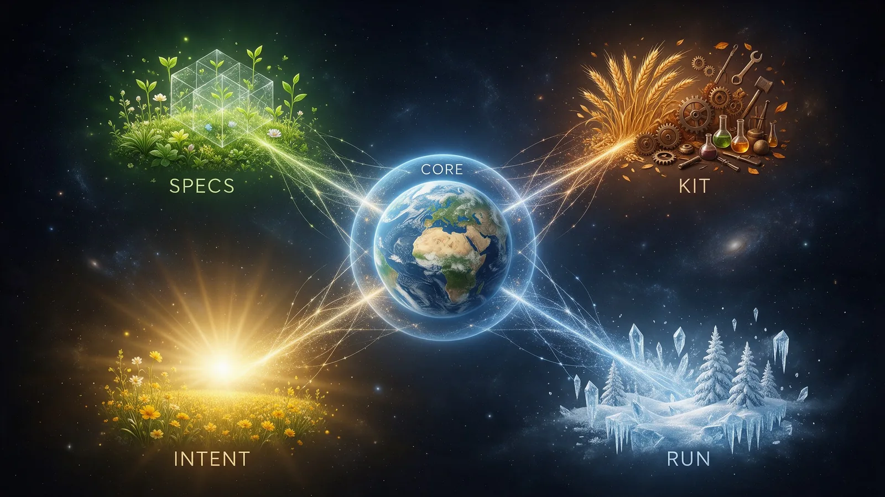

| Время года | Узел | Что делает |
|---|---|---|
| Весна | `Spec` | направляет: задаёт направление роста, части и границы, критерий готовности |
| Лето | `Intent` | желаемый результат: образ того, чего хотим и ради чего |
| Осень | `Kit` | определяет окружение: делает выводы о среде и собирает под задачу роль, навык, инструмент, доступ, данные |
| Зима | `Run` | действует: исполняет и тем самым готовит почву для следующего цикла |
| Земля | `Core` | держит круг: равновесие четырёх и вердикт по циклу |

Зима готовит следующую весну, поэтому цикл не заканчивается, а повторяется на остатке. Как в природе, ничего не делается не в своё время, и у каждого узла своя работа; проверяет её не тот, кто делал.

## Пять узлов

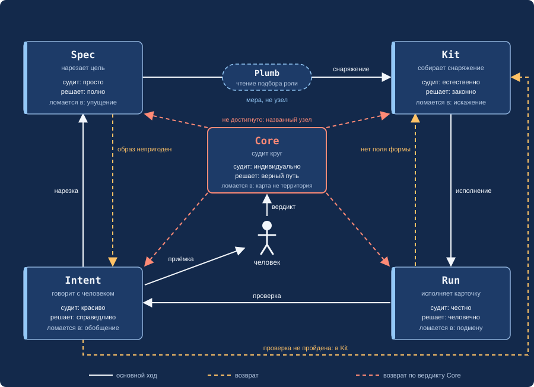

Пятеро — одно тело. Каждый судит своей парой критериев; без второй половины критерий вырождается.

| Узел | Судит | Придерживается | Теряет, если пара распалась | Пограничное чувство (держит равновесие) |
|---|---|---|---|---|
| `Intent` | красиво | справедливости | обобщение | страх |
| `Spec` | просто | совершенства | опущение | печаль |
| `Kit` | естественно | законности | искажение | радость |
| `Run` | честно | человечности | подмена | отвращение |
| `Core` | индивидуально | истинного пути | «карта не территория» | гнев |

`Plumb` (Отвес) — не шестой узел, а мера: между нарезкой и исполнением он читает, насколько роль подходит задаче. Ничего не решает и не подтверждает; решает `Spec`.

## Как идёт работа

Работа идёт по кругу пяти узлов. Начало — `Intent` слева внизу, дальше по часовой стрелке: `Spec` слева вверху, `Kit` справа вверху, `Run` справа внизу; в центре — `Core`. `Plumb` пристыкован к `Spec`.


1. `Intent` открывает цель вместе с человеком.
2. `Spec` нарезает цель на карточки и пишет критерий готовности.
3. `Plumb` читает, подходит ли роль из каталога. Подходит — карточка идёт сразу в `Run`.
4. Не подходит — `Kit` собирает снаряжение (шесть единиц) и создаёт или чинит роль.
5. `Run` исполняет карточку.
6. `Intent` проверяет результат по критерию; не прошёл — карточка возвращается в `Kit`.
7. Человек принимает видимый результат.
8. `Core` выносит вердикт по кругу: достигнута ли конечная картина. Не достигнута — назван узел, круг повторяется на остатке.

Прямого возврата в `Run` нет: карточку всегда пересобирает `Kit`.

## Plumb и JEV: точный подбор роли

Чтобы не готовить каждую задачу заново, «Форма» держит **каталог готовых ролей** исполнителей — у каждой записано, какие задачи она берёт и какие нет. Между нарезкой и исполнением работает `Plumb` (Отвес): он читает карточку и каталог и подсказывает, какая роль подходит точнее всего.

Читает `Plumb` с помощью технологии **JEV** — решающей модели, которая не пишет текст и ничего не объясняет, а возвращает три типизированных чтения:

| Чтение | Что отвечает |
|---|---|
| выбор | какая роль ближе всего, с вероятностью по каждой |
| ясность | насколько понятно сформулирована задача |
| «берёт ли» | возьмёт ли ведущая роль именно эту задачу, да или нет |

Решает не `Plumb`, а `Spec`: по порогам из `project/config/PROJECT.md` (вероятность ведущей роли и отрыв от второй). Роль подходит — карточка идёт сразу в `Run`, без комплектования. Не подходит — `Kit` создаёт точную роль и пополняет каталог, поэтому с каждым кругом долю карточек, которым нужен `Kit`, становится меньше.

**Что это даёт:**
- **Меньше расходов на подготовку.** Роль уже готова — задачу не собирают с нуля.
- **Точное использование компетенций.** Каждую задачу берёт роль с подходящей квалификацией, выбранная по вероятности, а не на глаз.
- **Каталог растёт.** Каждая сборка `Kit` оставляет или расширяет роль для будущих задач.

JEV — рекомендуемый исполнитель `Plumb`; переключается одной командой `node .claude/scripts/plumb-switch.cjs` и нужен ключ в `.env`. Без ключа, при ошибке или отказе очистки автоматически работает встроенная малая модель (haiku). Во внешнюю модель уходит только очищенный текст карточки: значения из `VARS/` и `.env` заменены именами, адреса и токены вычищены (запрет 17).

## Как узлы связаны с доской Kanban

Четыре колонки доски — это четыре узла: Backlog — `Spec`, To Do — `Kit`, In Progress — `Run`, Review — `Intent`. Пятый, `Core`, лежит под доской пластом и связан со всеми четырьмя: держит их равновесие и выносит вердикт по кругу. Две дуги сверху показывают пары-«прокладки»: `Spec` нарезает карточки для `Run`, а `Kit` готовит инфраструктуру под цель, которую определяет `Intent`. `Kit` и `Intent` стоят между `Spec` и `Run`, а `Spec` и `Run` — между `Kit` и `Intent`.

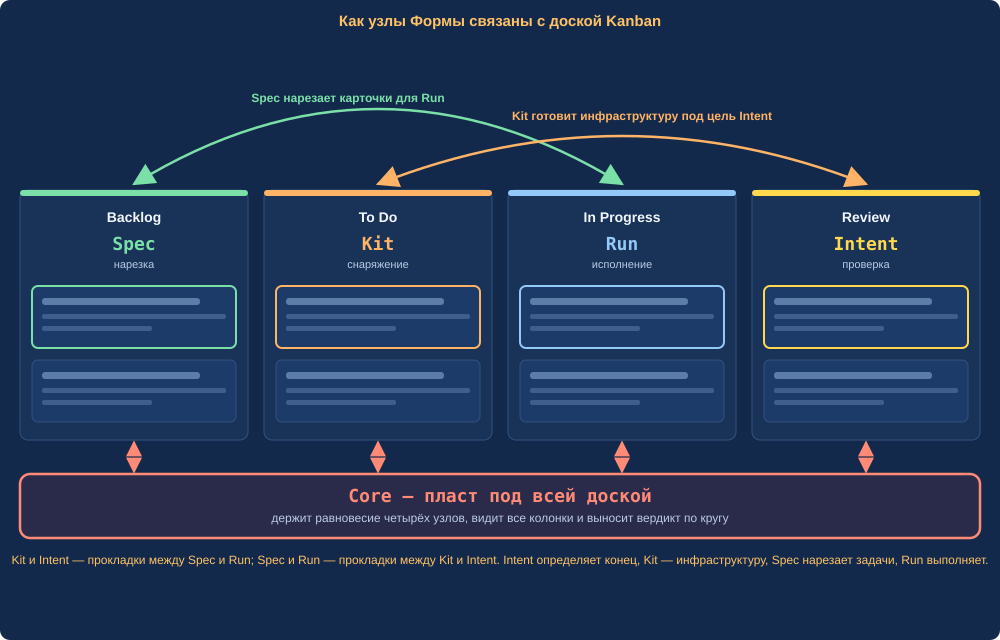

| Колонка | Узел (`assignee`) | Что происходит |
|---|---|---|
| Backlog | `Spec` | карточка нарезана, критерий записан |
| To Do | `Kit` | собраны шесть единиц снаряжения, подобрана роль |
| In Progress | `Run` | карточка исполняется по готовому комплекту |
| Review | `Intent` | результат сверяется с критерием и показывается человеку |
| Done (под доской) | `Core` | человек принял; `Core` закрывает круг вердиктом |

Возвраты идут по тем же колонкам: не прошла проверка — карточка из Review в To Do, к `Kit`; не достигнут вердикт — к узлу, который назвал `Core`.

## Как выглядит карточка задачи

Задача — это одна карточка: обычный `.md`-файл в `.devtool/features/`, который Kanban Markdown показывает на доске и открывает как форму. В нём два слоя: служебные поля сверху и четыре зоны текста.

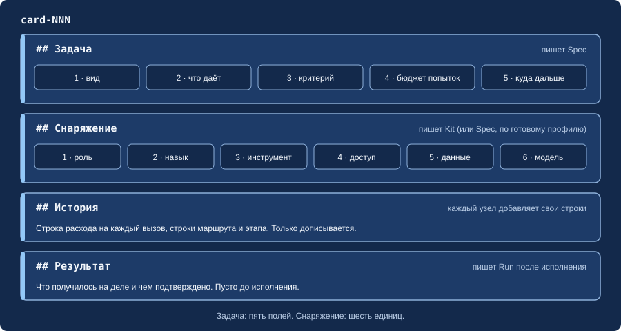

```
---
id: "card-NNN-contacts-page"
status: "in-progress"          # backlog → todo → in-progress → review → done
priority: "medium"
assignee: "Run"                # какой узел держит карточку сейчас
epic: "7. Каналы производства" # полоса карточек одного вида цели
labels: ["goal-channels", "route-7"]   # цель и маршрут
order: "a0"
---
# card-NNN · Страница «Контакты»

## Задача
NNN · дело | страница с формой связи | форма отправляет письмо, поля
проверяются, страница открывается на телефоне | 2 попытки | на проверку к Intent

## Снаряжение
Роль · Навык · Инструмент · Доступ · Данные · Модель

## История
- `Spec`, ГГГГ-ММ-ДД: stage card — карточка нарезана.
- `Kit`, ГГГГ-ММ-ДД: attempt, N tokens, T s — собрано снаряжение.

## Результат
(пусто до исполнения)
```

| Часть | Что в ней | Кто пишет |
|---|---|---|
| Служебные поля | `status` (колонка доски), `assignee` (узел, который держит карточку), `epic`, метки цели и маршрута | узел, который берёт карточку |
| `## Задача` | пять полей: вид · что даёт · критерий готовности · бюджет попыток · куда дальше | `Spec` |
| `## Снаряжение` | шесть единиц: роль, навык, инструмент, доступ, данные, модель | `Kit` |
| `## История` | строка на каждое событие: этап, попытка, расход токенов, возврат | каждый узел о своём событии, чужое не переписывает |
| `## Результат` | что получилось на деле, не хронология | `Run`, когда готово |

Карточку переносят по колонкам узлы: `status` и `assignee` меняются вместе. Принятая карточка уходит в `Done`.

## Дашборд

Кроме доски в редакторе у Формы есть свой дашборд — локальная страница проекта, она поднимается сама при старте сессии, ссылка приходит в первом сообщении. Она только показывает состояние: карточки правятся на доске. Вкладок восемь, ниже верх шести основных; ещё две — «Документация» (документация протокола прямо в дашборде) и «Графы» (графы мануала, движка, опыта, проекта и результата).

**Дашборд** — прогресс по эпикам, критический путь, таблица карточек.

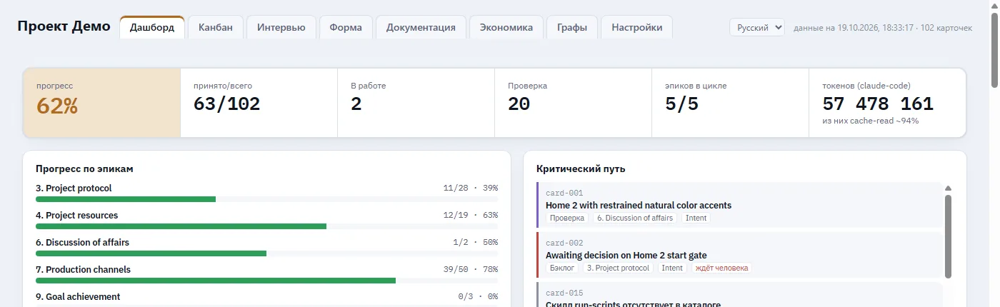

**Канбан** — доска проекта с фильтрами по цели, эпику и узлу.

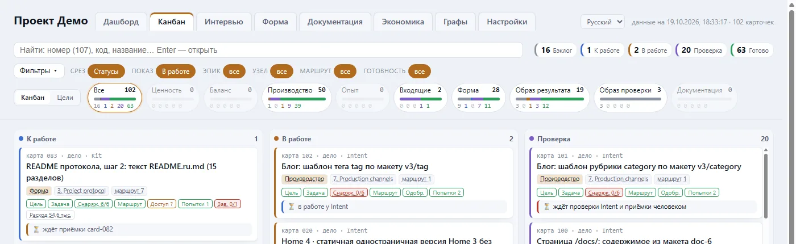

**Интервью** — ответы человека до первой цели — опорная точка `project/brief`.


**Форма** — карточка каждого узла: модель, скиллы, коннекторы, нагрузка.

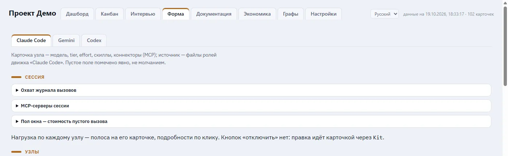

**Экономика** — расход токенов и кэша по узлам и карточкам.

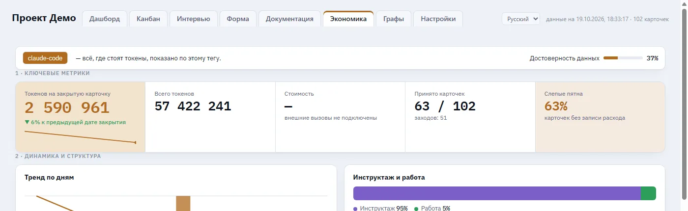

**Настройки** — пороги, маршруты, внешние сервисы.

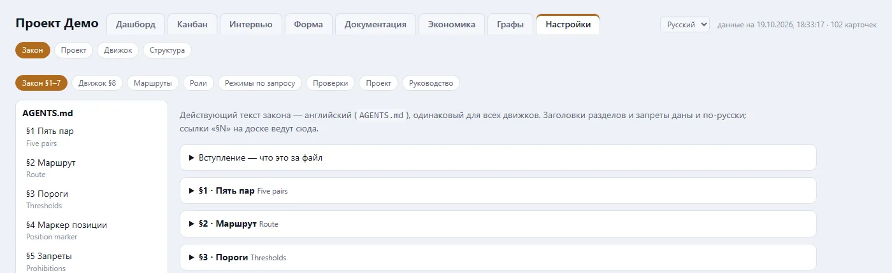

## Фразы для работы

С протоколом разговаривают с `Intent` — главной сессией. Формулировки свободные; жёстко задана только кодовая фраза.

| Что сказать | Что происходит |
|---|---|
| «Отключи сенсорику» | Кодовая фраза (ровно так). Разрешает один раз: снять защиту от удаления файлов схемы **или** выйти за маршрут для названной задачи. Не постоянное состояние; запись об этом остаётся в истории карточки. |
| «Покажи дашборд» | `Intent` даёт адрес дашборда (`http://localhost:5050/`); он стартует с каждой сессией, вручную — `node .forma/dashboard/ensure-running.js`. |
| «Обнови форму» | Обновление протокола в проекте (навык `/forma`); `project/`, доска и история не трогаются. |
| «Удали форму» / «удали протокол» | Сначала пробный запуск со списком: что уйдёт, что останется (`project/`, `.devtool/`, `.env`, `.mcp.json`). Само удаление — только после сообщения с кодовой фразой «Отключи сенсорику». |
| «Уровень доступа: малый / средний / полный» | Включает набор разрешений агента; действует со следующей сессии. `--show` покажет текущий, `--off` снимет. |
| «Передай круг в Core» | Закрыть цикл эпика вердиктом `Core`: обычно при достижении порога объёма, раньше — по твоей команде. |
| «Давай демонстрационный цикл» | Две небольшие карточки через весь маршрут за несколько минут; после — убираются, в статистику не входят. |

## Узлы

| Узел | Что делает | Судит | Куда возвращает |
|---|---|---|---|
| `Intent` | основная сессия с человеком: открывает цель, проверяет результат, предъявляет круг | красиво | в `Kit` при непройденной проверке; в `Spec`, если сделанное не ведёт к цели |
| `Spec` | нарезает цель на карточки, пишет критерий | просто | в `Intent`, если конечная картина допускает несколько прочтений |
| `Kit` | собирает снаряжение, создаёт и чинит роли | естественно | в `Spec`, если дело в карточке, а не в снаряжении; к человеку, если инструмента нет |
| `Run` | исполняет по готовому комплекту | честно | в `Kit`, если не хватает поля формы |
| `Core` | вердикт по кругу | индивидуально | к названному узлу, затем следующий круг |

## Почему пять и девять: соответствие методикам

«Форма» не собрана из методик — она описывает естественный способ, которым организуется любая совместная работа. Поэтому известные системы ведения проектов ложатся на неё как частные случаи: **пять узлов** и **девять видов цели (эпиков)** — общий каркас. Ниже — уже сопоставленные методики; список растёт.

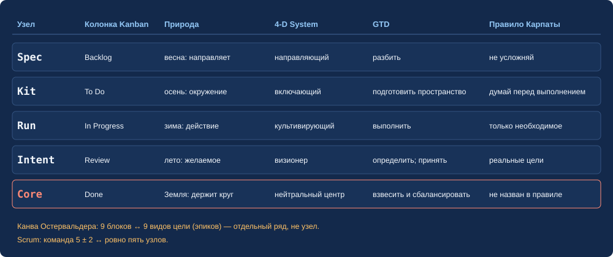

| Методика | Как ложится на «Форму» |
|---|---|
| **Правило Карпаты** (четыре принципа работы ИИ-агента) | Реальные цели — `Intent`; не усложняй — `Spec`; думай перед выполнением — `Kit`; делай только необходимое — `Run`. `Core` в правиле не назван — он сверяет, что четыре работают вместе. |
| **Scrum** (команда 5 ± 2) | Ровно пять узлов. |
| **4-D System** | Визионер — `Intent`; направляющий — `Spec`; включающий — `Kit`; культивирующий — `Run`; нейтральный центр, объединяющий четверых, — `Core`. |
| **GTD** | Определить — `Intent`; разбить — `Spec`; подготовить пространство — `Kit`; выполнить — `Run`; принять или вернуть — `Intent` и человек; взвесить узлы и сбалансировать — `Core`. |
| **Kanban** | Пять колонок доски — пять узлов ([схема выше](#как-узлы-связаны-с-доской-kanban)). |
| **Канва Остервальдера** | Девять блоков канвы — девять видов цели, один к одному (таблица ниже). |

Канва бизнес-модели и девять эпиков:

| № | Эпик | Блок канвы |
|---|---|---|
| 1 | Аналитика | Ценностное предложение |
| 2 | Структура проекта | Структура расходов |
| 3 | Протокол проекта | Ключевые виды деятельности |
| 4 | Ресурсы проекта | Ключевые ресурсы |
| 5 | Баланс формы | Ключевые партнёры (четыре узла под управлением `Core`) |
| 6 | Обсуждение дел | Взаимоотношения с клиентами |
| 7 | Каналы производства | Каналы |
| 8 | Сегменты компетенций | Сегменты потребителей |
| 9 | Достижение цели | Структура доходов |

Тезис автора: у этого каркаса нет альтернативы — остальные методики (PMBOK, Kanban, PRINCE2, OKR, Lean, Agile) сопоставимы с ним тем же способом. Подробности — в [руководстве](#полная-документация).

## Ключевые понятия

| Термин | Определение |
|---|---|
| Узел | Одна из пяти ролей; у каждой своя пара критериев. |
| Карточка | Файл на доске `.devtool/features/`: Задача, Снаряжение, История, Результат. |
| Пять полей | Вид и «что даёт» · критерий готовности · бюджет попыток · куда дальше. |
| Шесть единиц снаряжения | Роль, навык, инструмент, доступ, данные, модель. |
| Эпик | Полоса карточек одного вида цели; маршрута сам не несёт. |
| Цель | Образ результата; у карточки ровно одна метка `goal-…`. |
| Маршрут | Девять путей карточки `route-0…8`, от короткого до полного круга (`route-7`); метки `over-1…4` меняют одно звено. |
| Круг | Принятые карточки эпика, которые `Core` закрывает вместе вердиктом. |
| Пороги | Два числа в `PROJECT.md`: попытки на задачу, объём карточек на круг. |
| Строка расхода | Строка в `## История`: токены, кэш, время, id вызова; пишет вызывающий сразу после возврата. |
| Позиционный маркер | Первая строка передачи: `holding course`, `counting cost`, `assembling`, `preserving`. |
| Зоны чистоты | Файлы, уходящие в другие проекты, не содержат следов проекта (запрет 16). |
| Запреты | 18 фиксированных правил `AGENTS.md` §5; номер — постоянный адрес. |
| Слои файлов | Роли и навыки движка · ядро `.forma/` · расширения проекта · продукт `project/`. |

## Установка

**Нужно:** всё из [обязательных условий](#обязательные-условия) — прежде всего VS Code или Antigravity с расширением Kanban Markdown.

**Способ 1 — установщик (рекомендуется).** Из папки проекта:

```
npx github:IamForma/forma init
```

Установщик спрашивает: движки (`claude` готов; `codex`, `gemini` — бета), шаблон проекта (или без шаблона), канбан-доску, язык документов, окно автосжатия. Без вопросов: `npx github:IamForma/forma init --engines claude --template none --board auto`. В реестре npm пакета нет — только `github:`.

**Способ 2 — git-клон.**

```
git clone https://github.com/IamForma/forma.git protocol
```

Затем в сессии Claude Code: «прочитай protocol/skills/forma/SKILL.md и установи по нему протокол Форма». Обновление: `git -C protocol pull`, затем «обнови протокол Форма».

**Способ 3 — плагин Claude Code.**

```
claude plugin marketplace add IamForma/forma
claude plugin install forma@forma
```

Затем в проекте: `/forma`. Если обновление после `marketplace update` не появилось, кэш плагина устарел — используйте способ 2.

**Шаблоны проектов.** Шаблон добавляет поверх ядра готовый маршрут под тип дела; выбирается вопросом установщика. При способе 2 лежат в `protocol/templates/<имя>/`.

**После установки.**

- Дашборд стартует с каждой сессией; вручную: `node .forma/dashboard/ensure-running.js`.
- Проверка установки: `node .forma/verify/verify-install.cjs`.
- Задайте два порога (попытки, объём) в `project/config/PROJECT.md`.
- Интервью по `project/config/SETUP.md` ведёт `Intent`; в первой сессии он предлагает короткий демонстрационный цикл.

## Команды

Пути — от корня установленного проекта.

### Установка, обновление, удаление

| Команда | Что делает |
|---|---|
| `npx github:IamForma/forma init [--engines --template --board --lang --dir --compact --adopt/--no-adopt --yes --dashboard/--no-dashboard]` | Ставит ядро и адаптер; повторный запуск — обновление. |
| `npx github:IamForma/forma --version` | Печатает версию установщика. |
| `npx github:IamForma/forma uninstall [--dir <путь>] [--yes]` | Снимает протокол; без `--yes` — пробный запуск. |
| `npx github:IamForma/forma extensions [--check] [--dir <путь>]` | Копирует расширения проекта в папки движков; `--check` только сообщает о расхождениях. |
| `/forma` (в сессии Claude Code) | Навык: установка или обновление протокола. |
| `node .forma/verify/verify-install.cjs` | Проверяет установку (хуки, `bash`). |
| `node .forma/dashboard/ensure-running.js` | Запускает дашборд, если он не запущен. |

### Ежедневная работа

| Команда | Что делает |
|---|---|
| `node .forma/board/new-card.cjs --kind <код> --title "<…>" [--goal --type --route N --over N --after NNN --dry]` | Создаёт карточку с эпиком, номером и шаблоном. |
| `node .forma/board/card-move.cjs <card> --to kit\|run\|intent\|accept\|close --note "<…>" [--dry]` | Передаёт карточку следующему узлу: status, assignee, строка этапа. |
| `node .forma/board/run-in-card.cjs <card> -- <команда>` | Запускает скрипт в контексте карточки. |
| `node .claude/scripts/build-kit-graphs.cjs` | Строит графы Kit: цели, доска, арсенал; без вызова модели. |
| `node .claude/scripts/permissions-level.cjs <уровень>\|--show\|--off` | Включает, показывает или снимает уровень доступа. |
| `node .claude/scripts/plumb-run.cjs <card.md> [--root --site --out]` | Plumb через внешнюю решающую модель; при сбое — `{fallback:"haiku"}`. |
| `node .claude/scripts/plumb-switch.cjs [--root DIR]` | Переключает исполнителя Plumb с haiku на внешнюю модель; без ключа в `.env` останавливается. |
| `node .claude/scripts/plumb-scrub.cjs <card.md> [--root --site --out]` | Очищает карточку перед отправкой во внешнюю модель (запрет 17). |
| `node .claude/scripts/cycle-status.cjs [--json]` | Счёт круга по эпикам; только чтение. |

### Проверка и корректировка

| Команда | Что делает |
|---|---|
| `node .claude/scripts/sync-engines.cjs [--check] [--diff] [--quiet] [--file <путь>]` | Сверяет правила и роли между движками. |
| `node .forma/board/check-board.cjs [<card-id>]` | Проверяет доску карточек; код выхода 1 при нарушениях. |
| `node .forma/protocol/scripts/check-release.cjs [--no-tests \| --traces \| --message <файл> \| --prepush]` | Предвыпускная проверка: следы проекта, сообщения коммитов, тесты, линтер. |

### Разработка протокола

Из корня клона `.forma/protocol/`.

| Команда | Что делает |
|---|---|
| `npm test` | Запускает тесты. |
| `npm run lint` | Запускает линтер. |
| `npm run baseline:save` / `npm run baseline:diff` | Записывает и сравнивает снимок «до» для рефакторинга. |
| `npm run check:release` | То же, что `check-release.cjs` без флагов. |
| `node scripts/engine-to-protocol.cjs [--apply \| --add <путь> \| --mark \| --before-push]` | Переносит правки движка проекта в исходник протокола; без флагов только показывает. |
| `node scripts/forma-commit.cjs "<сообщение>" [--check \| --release \| --push \| --sync-staged \| --install-hook]` | Коммит движка без дрейфа; `--release` — выпуск dev → main. |
| `node scripts/template-push.cjs --template <имя> --add <путь> [--mcp --note --apply]` | Публикует обезличенные файлы в шаблон; без `--apply` — пробный запуск. |

## Структура файлов после установки

```
AGENTS.md          закон, §1–7
.claude/           адаптер Claude Code: agents/, hooks/, scripts/, skills/, rules/, settings.json
.codex/  .agents/  адаптеры Codex и Gemini (бета)
.forma/            ядро: board/, dashboard/, manual/, living/, verify/, extensions/, i18n/,
                   install-manifest.json, protocol/ (клон при способе 2)
project/           продукт: config/, brief/, extensions/, cards/, ops/ — обновление не трогает
.devtool/features/ доска карточек; done/ — принятые
```

Три слоя (`AGENTS.md` §6): 1 — роли и навыки движка; 2 — `.forma/`, ядро, одно для всех проектов; 3 — продукт (`project/`, `.forma/living/`, `.devtool/`), с расширениями проекта в `project/extensions/<движок>/`.

## Версия и обновление

- **Какая версия стоит.** `npx github:IamForma/forma --version`; в проекте — поле `version` в `.forma/install-manifest.json`.
- **Уведомление.** Раз в сутки при старте сессии Claude Code хук сравнивает версию с последней на GitHub и говорит, только если на GitHub новее. Без сети молчит.
- **Обновить.** Снова `npx github:IamForma/forma init` в папке проекта; `project/`, доска и `living/` сохраняются.
- **Окно автосжатия.** Установщик предлагает 250000 токенов (`.claude/settings.json`) и не перекрывает ваше значение. `--compact <токены>` задаёт другое, `--compact off` оставляет умолчание Claude Code.

## Если что-то не работает

- **Установщик ничего не вывел.** Повторите команду; если снова пусто — удалите папку `_npx` в кэше npm (`npm config get cache`) и повторите. Причина — устаревший кэш `npx`.
- **Хуки ничего не делают.** Claude Code запускает хуки через `bash`. На Windows поставьте Git for Windows и повторите установку. Проверка: `node .forma/verify/verify-install.cjs`.
- **Команда заблокирована хуком guard-delete.** Файлы и папки самой схемы (`.claude/`, `.agents/`, `.codex/`, `.devtool/`, `.forma/manual/`, `.forma/living/`, `AGENTS.md`, `PROJECT.md`, любой `GOAL.md`) защищены от удаления. Разрешить ровно одну команду — кодовой фразой из `AGENTS.md` §2.

## Полная документация

- Сайт: [yaforma.pro](https://yaforma.pro/) (RU), [iamforma.pro](https://iamforma.pro/#intro) (EN) — как это работает, сообщество.
- Руководство: `.forma/manual/ru/` и `.forma/manual/en/` (в репозитории — `skills/forma/core/manual/`).
- Прежний подробный README: [ru](skills/forma/core/manual/ru/archive/README-full.md) · [en](skills/forma/core/manual/en/archive/README-full.md).
- Адаптер нового движка: [docs/ADAPTER.ru.md](docs/ADAPTER.ru.md).

## Вклад и разработка

- Коммиты протокола — только на английском (запрет 18); сообщение с кириллицей останавливает `forma-commit.cjs` и проверку перед пушем.
- Перед выпуском: `npm test`, `npm run lint`, `npm run check:release`.
- Работа идёт в ветке `dev`; выпуск в `main` — `forma-commit.cjs --release`.

## Лицензия

[MIT](LICENSE)
